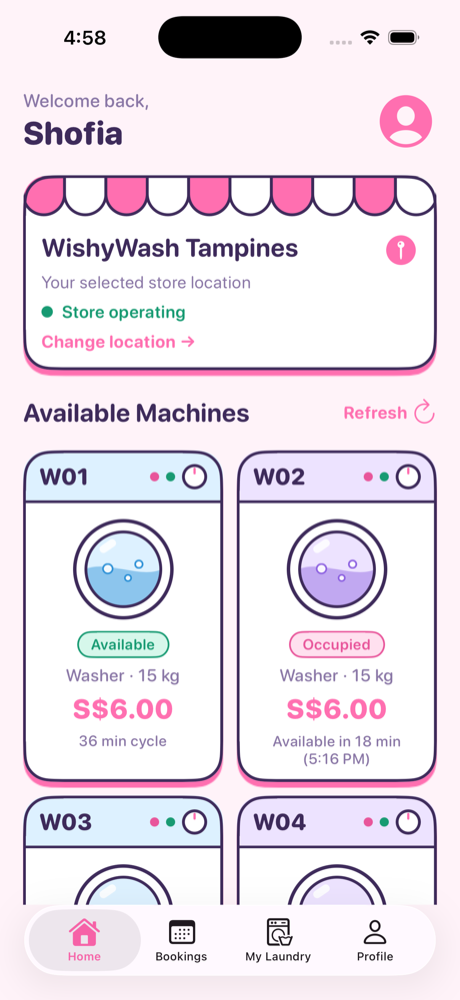
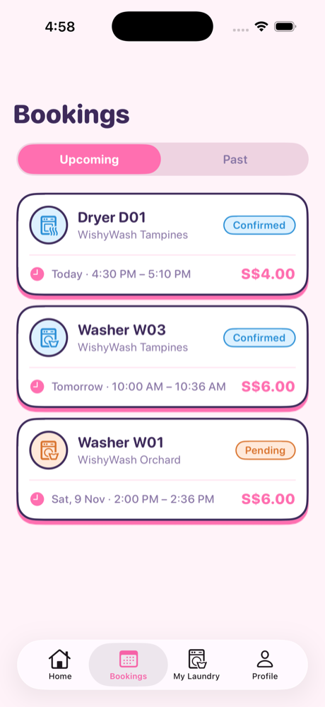
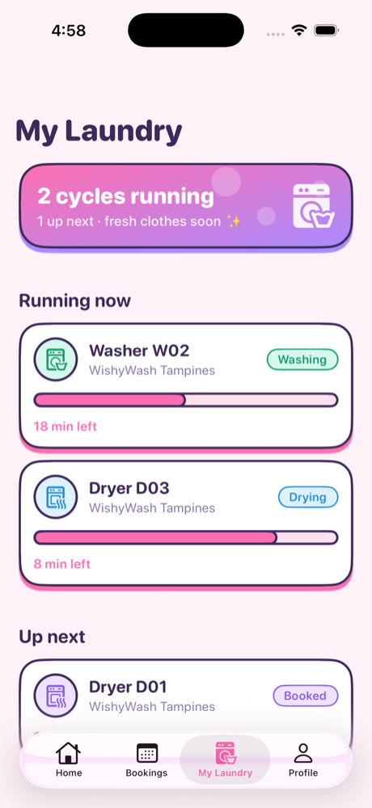
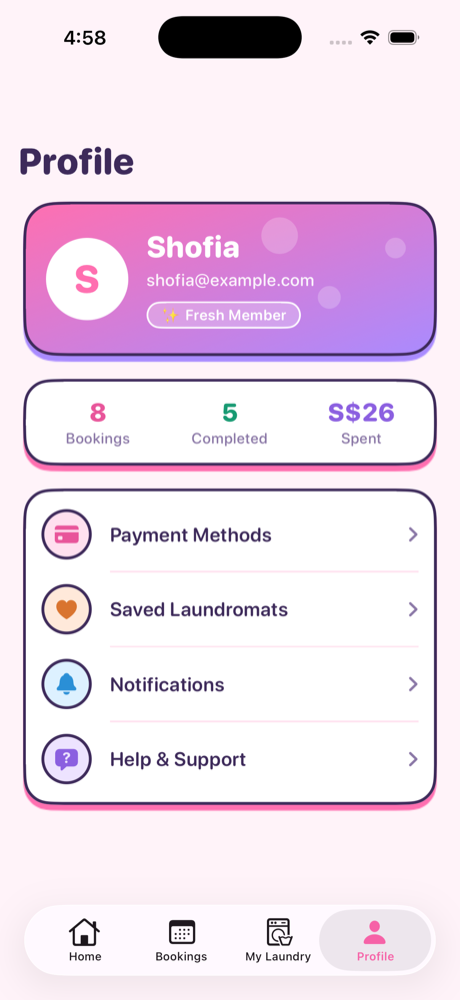
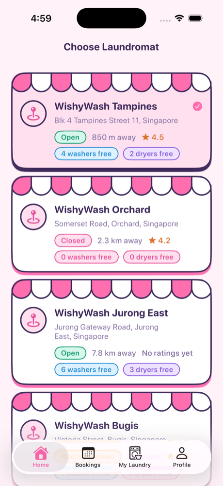
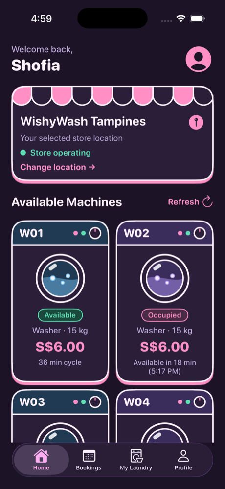
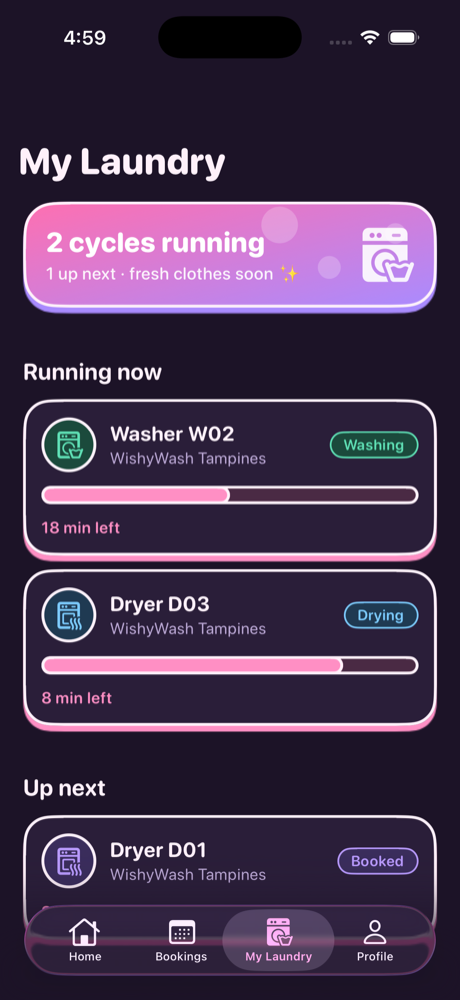

# 🫧 WishyWashy

A bubblegum-modern iOS app for finding and booking washers and dryers at self-service laundromats around Singapore. Built with UIKit.

> **Status:** the UI is done. The Bookings, My Laundry, Profile and Choose Laundromat pages show static sample data. Home runs on mock data through its VIPER module. Real data and logic come next.

## Screenshots

| Home | Bookings | My Laundry |
|:---:|:---:|:---:|
|  |  |  |

| Profile | Choose Laundromat |
|:---:|:---:|
|  |  |

### Dark mode

| Home | My Laundry |
|:---:|:---:|
|  |  |

## Features

### Home
- Welcome header with a shortcut to your profile
- Selected laundromat card with a shop awning, open/closed status and a **Change location** link
- Grid of machines drawn as little cartoon washing machines, with a control panel, knob and a porthole with bobbing bubbles
- Each machine shows availability, type and capacity, price per cycle, and cycle length or time until free

### Bookings
- **Upcoming / Past** toggle
- Booking cards with machine, laundromat, date and time, price, and a status badge (Confirmed, Pending, Completed, Cancelled)

### My Laundry
- Summary card showing how many cycles are running
- **Running now** cycles with a live-style progress bar and time left
- **Up next** section for booked cycles

### Profile
- Gradient profile card with avatar, email and member badge
- Stats for bookings, completed and total spent
- Menu rows for Payment Methods, Saved Laundromats, Notifications and Help & Support

### Choose Laundromat
- Store cards with open/closed status, distance, rating and the address
- Free washer and dryer counts for every laundromat
- Currently selected store is highlighted

## Design: "Bubblegum modern, cartoon laundromat"

- **Palette:** pastel pink, blue, lilac, mint and peach on a soft pink background
- **Type:** rounded system font
- **Cartoon details:** thick plum outlines, hard pink "sticker" shadows, striped scalloped shop awnings and washing machine portholes
- **Dark mode:** supported throughout
- The design system lives in [`Shared/`](wishywashy/Shared): `Theme.swift` (colors, fonts, bar styling), `CardView.swift` (cards, gradient hero, icon bubble, progress bar) and `LaundryDecor.swift` (awning and porthole)

## Project structure

```
wishywashy/
├── Entities/      Machine, Laundromat, Booking, Payment, User
├── Mocks/         Sample data used by Home
├── Modules/
│   ├── Home/          VIPER module (view, presenter, interactor, router)
│   ├── Booking/       Bookings page (UI only)
│   ├── MyLaundry/     My Laundry page (UI only)
│   ├── Profile/       Profile page (UI only)
│   └── LaundromatList/  Choose Laundromat page (UI only, VIPER stubs commented out)
├── Shared/        Theme and reusable cartoon views
└── MainTabBarController.swift
```

## Getting started

1. Open `wishywashy.xcodeproj` in Xcode.
2. Pick an iPhone simulator (the deployment target is iOS 26).
3. Press **Run**.

## Roadmap

- [ ] Connect Bookings, My Laundry, Profile and Choose Laundromat to presenters, interactors and routers
- [ ] Make laundromat selection update Home
- [ ] Booking flow and payments
- [ ] Laundromat details page
- [ ] Real data source
