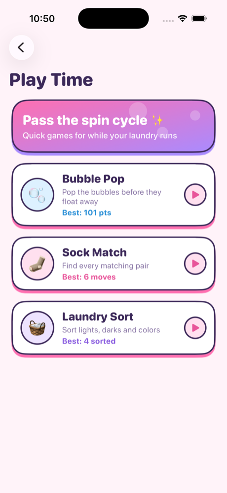
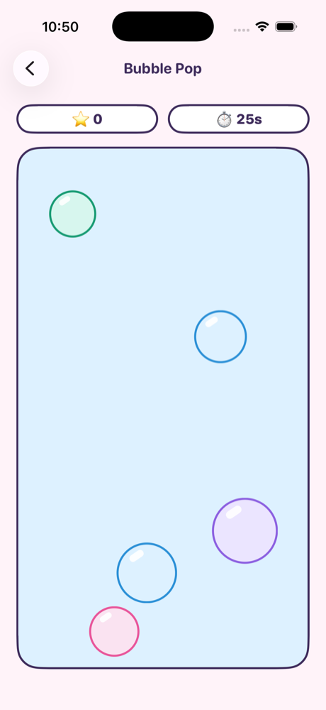
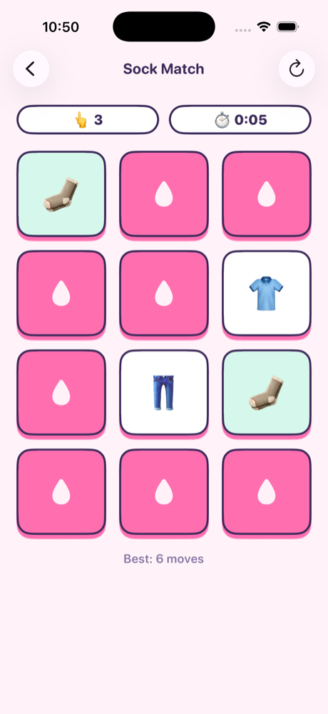
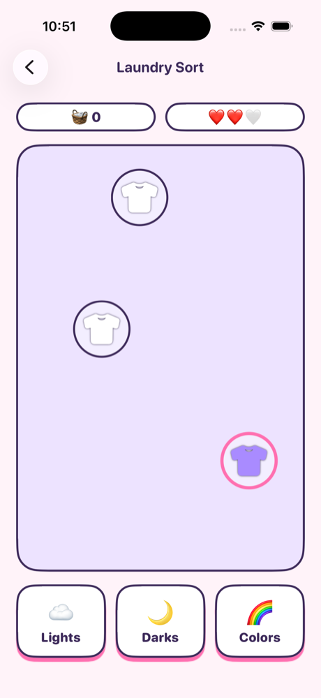
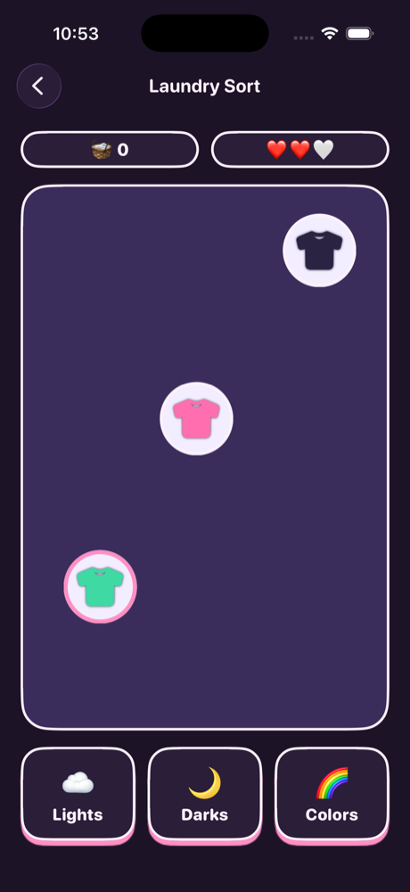

# 🫧 WishyWashy

A bubblegum-modern iOS app for finding and booking washers and dryers at self-service laundromats around Singapore. Built with UIKit.

## What it is

WishyWashy lets people **find, reserve and pay for a washer or dryer** at a self-service laundromat, so they do not
turn up to find every machine busy. You see which machines are free, reserve one now or for later, get told when to
leave so you arrive on time, check in at the machine, pay, and watch the cycle run. Three mini games keep you busy
while you wait.

> **Status:** a complete iOS app on **sample data**. Reservations, check-in, the payment flow, arrive-on-time
> reminders, bookings, profile and the games all work, and the booking rules have unit tests. There is no server yet:
> laundromats, machines, bookings and payments are simulated on the device. The plan for real data, real payments,
> machine integrations and Android is in [`docs/PRODUCT_AND_BACKEND_PLAN.md`](docs/PRODUCT_AND_BACKEND_PLAN.md).

## Screenshots

| Home | Bookings | My Laundry |
|:---:|:---:|:---:|
|  |  |  |

| Profile | Choose Laundromat |
|:---:|:---:|
|  |  |

### Mini games

| Games hub | Bubble Pop | Sock Match | Laundry Sort |
|:---:|:---:|:---:|:---:|
|  |  |  |  |

### Dark mode

| Home | My Laundry | Laundry Sort |
|:---:|:---:|:---:|
|  |  |  |

## Features

### Home
- Welcome header with a shortcut to your profile
- Selected laundromat card with a shop awning, open/closed status and a **Change location** link
- Grid of machines drawn as little cartoon washing machines, with a control panel, knob and a porthole with bobbing bubbles
- Each machine shows availability, type and capacity, price per cycle, and cycle length or time until free
- Tap a machine to **reserve** it. Choose **Now** or **Later**:
  - **Now:** a free machine starts straight away. A busy machine that frees up within 15 minutes can be reserved for when it frees up.
  - **Later:** pick a day (today and two more) and a free time slot, every 30 minutes between 7 AM and 11 PM. Times already taken, or too close to another booking, are not offered.
  - After the start time you have **10 minutes to check in**, or the booking expires and the machine is released. Nothing is charged until you check in.
  - Up to 5 upcoming bookings at once, and one reservation waiting for check-in at a time.

### Bookings
- The full schedule and history: every booking with its price and status
- Tap a booking you have not checked in to yet to **cancel it for free**
- **Upcoming / Past** toggle
- Booking cards with machine, laundromat, date and time, price, and a status badge (In progress, Reserved, Confirmed, Pending, Completed, Cancelled, Expired)

### Payments
You pay when you check in, not when you reserve. The payment sheet offers cards (Visa, Mastercard), PayNow and Apple Pay, and the cycle only starts once the payment succeeds.

- The app uses a built-in test payment sheet, so the whole flow works with no payment provider. No real money moves.
- If the machine is lost while you are paying, the payment is refunded and you are told.

### Arrive on time
Open it by tapping a booking in **Bookings**, or a reservation or the next booking in **My Laundry**, then **Check if I can arrive on time**.

- Gets your location once (Core Location), asks Apple Maps (MapKit) for the travel time by car, on foot or by public transport, and compares your arrival with the booking's start time
- Works out when to leave, with a 10 minute safety buffer. For a 5:00 PM start and a 25 minute trip, that is 4:25 PM
- Says whether you are fine, should leave now, would be late but still inside the 10 minute check-in window, or would miss the booking
- **Remind me to leave** schedules a local notification (UserNotifications) for the leave time. Recalculating replaces it, and cancelling or checking in removes it
- The estimate is labelled as an estimate, and **Recalculate** works it out again at any time
- A "leave in X min" countdown shows in the sheet, and the next booking on My Laundry shows "leave by" and then "Time to leave" in the app, so it works even without notifications

| Location | Notifications | What happens |
|---|---|---|
| Denied | Denied | Enter a starting place or travel time by hand. A countdown and "Time to leave" show in the app. Nothing is scheduled. |
| Denied | Allowed | Same manual input, and a notification is scheduled. |
| Allowed | Denied | Travel time comes from Apple Maps. The countdown and "Time to leave" show in the app, with a shortcut to Settings. |
| Allowed | Allowed | Travel time comes from Apple Maps and a notification is scheduled. Location is requested once, not tracked. |

Departure reminders can also be switched off in Profile > Notifications.

### My Laundry
- The live view: what is running right now and what is next, with no prices or history
- Summary card showing how many cycles are running
- Tap the next booking to cancel it or check your arrival time
- **Reserved** machine with a countdown. Tap it to **check in and start** (stands in for scanning the QR code on the machine). Checking in is when you **pay**. Or cancel it for free. If the previous user is still at the machine, check-in waits. An unused reservation expires and the machine is released.
- **Running now** cycles with a live-style progress bar and time left
- **Up next** section for the next booked cycle
- **All bookings** button that jumps to the Bookings tab
- **Play while you wait** card that opens the mini games

### Mini games
Reached from the **Play while you wait** card on My Laundry. The hub lists three games with your best score for each, saved on the device.

- **Bubble Pop:** pop as many floating bubbles as you can in 30 seconds. Small bubbles rise faster and score more.
- **Sock Match:** a memory game that gets harder with every level. Each level shows all the cards for a moment, then you match the pairs against a countdown.
  - The grid grows from 3 pairs up to 12 (3, 4, 6, 8, 10, 12).
  - The preview gets shorter and wrong pairs flip back faster.
  - From level 3, a wrong pair costs 2 seconds.
  - After level 6 the grid stays at 12 pairs, but the clock keeps tightening.
  - Your best is the highest level cleared.
  - **Daily challenge:** the calendar button in the nav bar switches to a deck that is the same for everyone on the same day. It never adapts, and its best is kept per day.
- **Laundry Sort:** tap the Lights, Darks or Colors basket for the lowest falling item before it hits the bottom. It speeds up as you score, and you have three lives.

#### Built with GameplayKit
Shared pieces live in [`Modules/Games/Gameplay/`](wishywashy/Modules/Games/Gameplay).

- **State machines** (`GKStateMachine`): ready, playing and over for the arcade games, and a round flow for Sock Match (peeking, picking, resolving, won, lost). Delayed work such as the flip-back is dropped when the state moves on.
- **Entities and components** (`GKEntity`, `GKComponentSystem`): bubbles and garments are entities with view, motion, score and tone components.
- **Agents** (`GKAgent2D`, `GKGoal`): bubbles wander and separate from each other so they do not pile up.
- **Distributions** (`GKShuffledDistribution`, `GKGaussianDistribution`): bubble colours, garment types and spawn lanes cycle fairly, and bubble sizes cluster around the middle.
- **Rule system** (`GKRuleSystem`): fuzzy rules over accuracy, streaks and recent misses set the pace (Chill, Steady or Frantic). It changes spawn rate and speed in Bubble Pop and Laundry Sort, and the preview and flip-back timing in Sock Match.
- **Seeded random source** (`GKMersenneTwisterRandomSource`): deals the same Sock Match deck for the daily challenge.

### Profile
- Gradient profile card with avatar, email and member badge
- Stats for bookings, completed and total spent
- Menu rows that each open their own page:
  - **Payment Methods:** saved cards, e-wallets and Apple Pay. Tap one to set it as default or remove it, and use + to add one.
  - **Saved Laundromats:** heart a laundromat to save it. Saved ones are listed first, and the choice is kept on the device.
  - **Notifications:** switches for cycle finished, booking reminders, machine available and offers, kept on the device.
  - **Help & Support:** common questions, plus email links to contact support.

### Choose Laundromat
- Real laundromats near you from Apple Maps, using your location (the app asks for permission)
- Search a place or postal code to see laundromats there instead; clearing the search goes back to near you
- Partner laundromats (with machines) are listed alongside, when they are within 25 km
- A **Sort by** row of chips: Distance, Rating, Name, Price and Open now
- Store cards with open/closed status, distance, rating and the address. Laundromats from Apple Maps have no machine, rating or hours data yet, and say so
- Free washer and dryer counts for every laundromat
- A heart on each card to save the laundromat; saved ones appear under Profile > Saved Laundromats
- Currently selected store is highlighted

## Design: "Bubblegum modern, cartoon laundromat"

- **Palette:** pastel pink, blue, lilac, mint and peach on a soft pink background
- **Type:** rounded system font
- **Cartoon details:** thick plum outlines, hard pink "sticker" shadows, striped scalloped shop awnings and washing machine portholes
- **Dark mode:** supported throughout
- The design system lives in [`Shared/`](wishywashy/Shared): `Theme.swift` (colors, fonts, bar styling), `CardView.swift` (cards, gradient hero, icon bubble, progress bar) and `LaundryDecor.swift` (awning and porthole). The game-only views (score pills, game-over card) live in `Modules/Games/Support/`

## Project structure

```
wishywashy/
├── App/             AppDelegate, SceneDelegate, MainTabBarController
├── Entities/        Plain models: Machine, Laundromat, Booking, Payment, User, ArrivalPlan
├── Modules/         One folder per screen flow. Each has a presenter, interactor, router and Views/
│   ├── Home/
│   ├── Booking/
│   ├── Reserve/
│   ├── MyLaundry/
│   ├── ArrivalCheck/
│   ├── LaundromatList/
│   ├── Profile/       with sub-pages for payments, saved laundromats, notifications and help
│   └── Games/         Games hub, Bubble Pop, Sock Match, Laundry Sort
│       ├── Gameplay/  GameplayKit pieces (state machines, entities, difficulty rules, random)
│       └── Support/   Game loop, saved best scores and the shared game views
├── Services/        What the screens call. Interactors get these through their init, so tests can swap them
│   ├── Bookings/      BookingService (protocol), LocalBookingService (the rules, on the device), BookingRules
│   ├── Payments/      PaymentService, the test payment sheet, payment and saved-method stores
│   ├── Arrival/       Travel time, leave-by maths, location and arrival plans
│   ├── Laundromats/   Selected and saved laundromats, Apple Maps search, partner list
│   ├── Notifications/ Local notifications and the user's preferences
│   └── Storage/       LocalStore, the only code that touches UserDefaults
├── SampleData/      Seed machines and bookings for the first launch
└── Shared/          Theme, reusable cartoon views, Money
```

Screens talk to a `BookingService` protocol. `LocalBookingService` answers on the device today, and a server version can replace it without touching any screen.


## Getting started

1. Open `wishywashy.xcodeproj` in Xcode.
2. Pick an iPhone simulator (the deployment target is iOS 26).
3. Press **Run**.

## Roadmap

Done:

- [x] Home, Bookings, My Laundry, Profile and Choose Laundromat, each as its own VIPER module
- [x] Reserve now, finishing-soon and later bookings, with check-in, free cancel, expiry and overlap checks
- [x] Payment at check-in with a test sheet, and a refund if the machine is lost while paying
- [x] Arrive-on-time check with a leave reminder
- [x] Three mini games
- [x] Services layer behind protocols, so a server can replace the on-device logic without touching any screen
- [x] Unit tests for the booking rules

Next (the full reasoning, data model, payments, Android and a phased checklist are in
[`docs/PRODUCT_AND_BACKEND_PLAN.md`](docs/PRODUCT_AND_BACKEND_PLAN.md)):

- [ ] **Server and database:** Postgres, sign-in with phone OTP and Sign in with Apple, booking API, a database
  constraint that makes double-booking impossible, and a worker that expires holds
- [ ] **`RemoteBookingService`** in the app, behind the existing `BookingService` protocol
- [ ] **Real users:** accounts, Keychain tokens, account deletion
- [ ] **Per-laundromat settings:** opening hours, time zone and currency (the app is hard-coded to S$ today)
- [ ] **One pilot laundromat:** owner dashboard, staff screen, QR check-in, machine status that says "Estimated" or "Live"
- [ ] **Machine integrations:** a capability model, adapters for cloud APIs, retrofit controllers and manual machines
- [ ] **Real payments** for Singapore (PayNow, cards, wallets) and the Philippines (GCash, Maya, cash), with webhooks,
  refunds and a ledger
- [ ] **Cash handling** for manned shops: staff app, shift reconciliation
- [ ] **Monetisation:** booking fee, subscription for manned shops, commission for unmanned
- [ ] **Server push notifications** instead of local ones
- [ ] **Android app** (native Kotlin and Jetpack Compose) on the same API
- [ ] Laundromat details page
- [ ] Trigger the games from a running cycle, for example when a wash is about to finish
