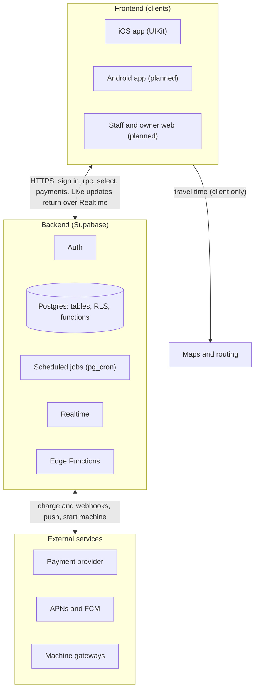
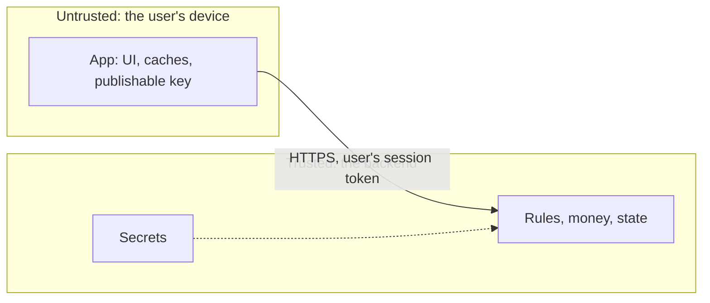
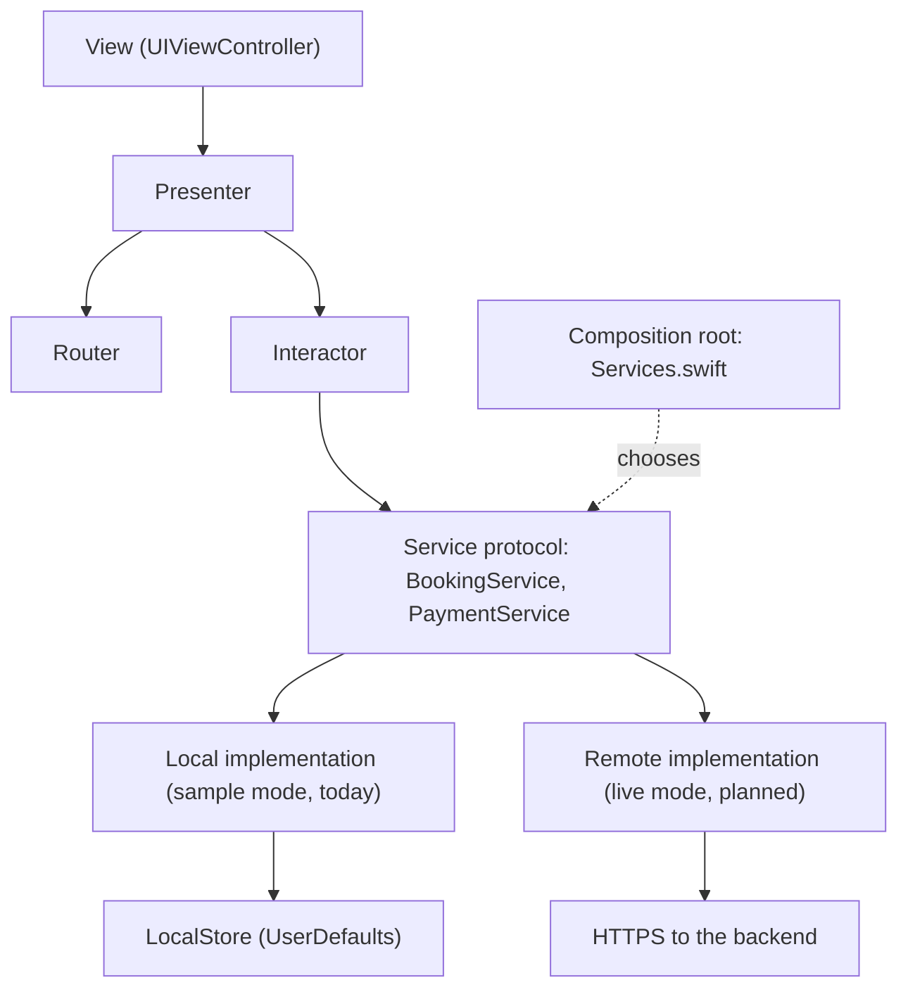
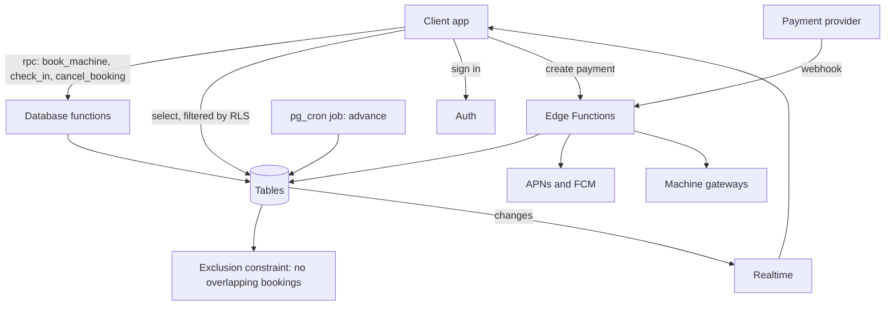
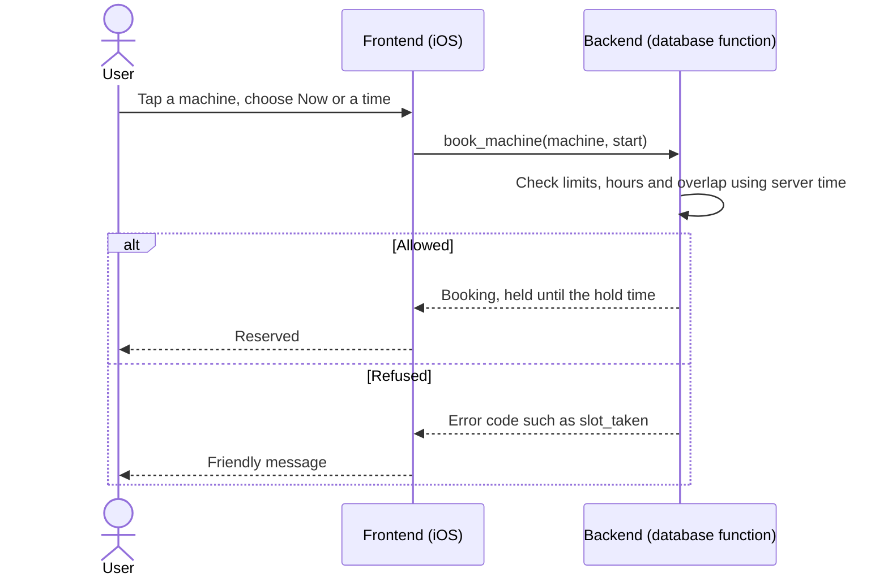
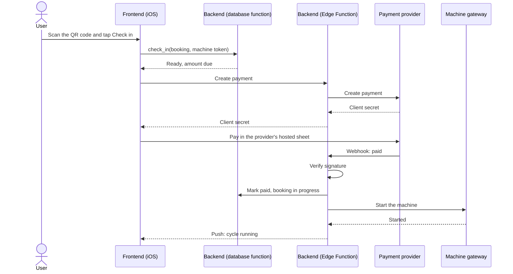
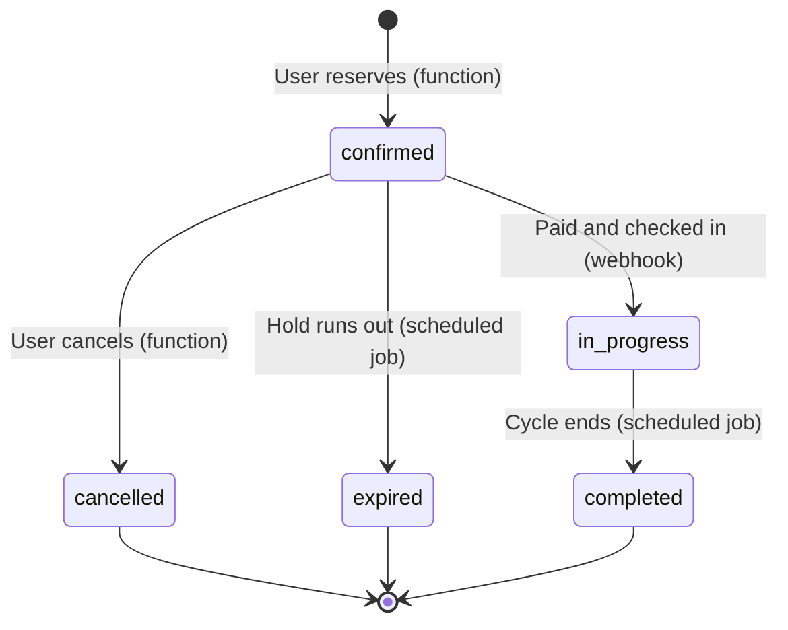

# Architecture: frontend and backend

This document separates the two halves of WishyWashy and says which one is responsible for what.
For the product reasoning, payments, machine brands and the phased to-do list, see
the private product plan (`private/PRODUCT_AND_BACKEND_PLAN.md`, kept on the owner's Mac only).

**Status:** the frontend runs on its own and does not use the backend yet. It plays the part of the backend itself,
using sample data and rules that run on the phone. The backend now exists in [`backend/`](../../backend): the database,
the booking rules as database functions, the security rules and 32 automated tests, with a step-by-step guide in
[backend/README.md](../../backend/README.md). It has not been connected to the app, and payments, push and staff features
are not built. This document describes where each responsibility lives now and where it moves to.

## Contents

1. [The two sides](#1-the-two-sides)
2. [System overview](#2-system-overview)
3. [Who is responsible for what](#3-who-is-responsible-for-what)
4. [Trust boundary](#4-trust-boundary)
5. [Frontend architecture](#5-frontend-architecture)
6. [Backend architecture](#6-backend-architecture)
7. [How they talk: the contract](#7-how-they-talk-the-contract)
8. [Key flows](#8-key-flows)
9. [Today versus target](#9-today-versus-target)
10. [Repository layout](#10-repository-layout)
11. [Environments](#11-environments)
12. [Where does new code go?](#12-where-does-new-code-go)

---

## 1. The two sides

| | Frontend | Backend |
|---|---|---|
| **What it is** | The apps people hold: iOS today, Android and a staff web page later | Supabase: Postgres, auth, scheduled jobs, realtime, Edge Functions |
| **Runs on** | The user's phone | Servers you do not control the hardware of |
| **Language** | Swift (UIKit, VIPER) | SQL (Postgres functions) and TypeScript (Edge Functions) |
| **Job** | Show things, collect input, give fast feedback | Decide things, store things, move money, talk to machines |
| **Can be trusted?** | **No.** A user can modify their phone, clock and network traffic. | **Yes.** It is the only place rules and money are enforced. |
| **Holds secrets?** | Only publishable keys | All secrets |
| **Lives in** | [`ios/`](../../ios) (and `android/` later) | [`backend/`](../../backend) |

The one-line rule: **the frontend asks and shows, the backend decides and remembers.**

---

## 2. System overview



Notes:

- Clients talk to the backend over HTTPS only. They never talk to the payment provider's servers or to machines
  directly, except to show the provider's hosted payment sheet.
- Maps and routing are called from the client (MapKit on iOS), because they need the user's location and do not touch
  money or rules.

---

## 3. Who is responsible for what

| Concern | Frontend does | Backend does |
|---|---|---|
| **Booking rules** (limits, overlaps, opening hours, check-in window) | Shows messages and hides options that obviously will not work | **Enforces** them in database functions and a database constraint, using the server clock |
| **Time passing** (hold expiry, cycle completion) | Shows countdowns and progress | Scheduled job moves state forward, even when nobody has the app open |
| **Machine status** | Shows it, labelled "Estimated" or "Live" | Source of truth. Reads from machine gateways, staff and timers |
| **Users** | Sign-in screens, keeps the session in the Keychain | Auth, profile, roles, account deletion |
| **Payments** | Opens the provider's hosted sheet and shows the result | Creates payments, verifies webhooks, refunds, keeps the ledger |
| **Notifications** | Asks permission, schedules a local "leave now" fallback | Sends push for hold expiring, cycle finished, leave now |
| **Data** | Caches what it shows. Keeps device-only things: selected laundromat, preferences, game scores, arrival plans | Stores every real record |
| **Travel time and location** | MapKit and Core Location | Nothing |
| **Games** | Everything | Nothing (a leaderboard would be the only reason to change that) |
| **Staff and cash** | Staff screens (planned) | Cash records, shift reconciliation, audit log |
| **Secrets** | Project URL and publishable key only | Service key, provider keys, webhook secrets |

---

## 4. Trust boundary



Rules that follow from this:

1. **Anything the app checks, the backend must check again.** The app's checks are for speed and friendly messages only.
2. **Never use the device clock for a decision that matters.** Expiry, hold windows and "is it open" use the server's time.
3. **Clients cannot write bookings or payments directly.** They call functions. Row-level security blocks direct writes.
4. **No secret ever ships in the app or the repo.** The service key, payment provider keys and webhook secrets live in
   Edge Function secrets.
5. **A payment is never marked paid because the app said so.** Only a verified provider webhook can do that.
6. **Card details never touch either side.** The provider's hosted sheet holds them.

---

## 5. Frontend architecture

The iOS app is UIKit with VIPER modules. Screens never touch storage, rules or the network directly. They go through a
service **protocol**, and a **composition root** decides which implementation sits behind it.



| Layer | Folder | Knows about |
|---|---|---|
| View | `Modules/*/Views` | The presenter only. No business logic. |
| Presenter | `Modules/*/*Presenter.swift` | Turns data into view models and text |
| Interactor | `Modules/*/*Interactor.swift` | Calls services. Receives them through `init`, defaulting to `Services` |
| Router | `Modules/*/*Router.swift` | Builds modules and navigates |
| Service protocol | `Services/Bookings/BookingService.swift`, `Services/Payments/PaymentService.swift` | The contract the screens rely on |
| Implementation | `Services/Bookings/LocalBookingService.swift` and others | Rules and storage (local today) |
| Storage | `Services/Storage/LocalStore.swift` | The only code that touches `UserDefaults` |
| Entities | `Entities/` | Plain models shared by everything above |
| Sample data | `SampleData/` | Seed machines and bookings for sample mode |
| Shared UI | `Shared/` | Theme, cartoon views, money formatting |

Frontend-only features that never move to the backend: the games (`Modules/Games`), travel time
(`Services/Arrival`), the theme, and device preferences.

---

## 6. Backend architecture

On Supabase. The tables, security rules and booking functions below are written and tested in
[`backend/supabase/migrations`](../../backend/supabase/migrations) (guide: [backend/README.md](../../backend/README.md)).
Edge Functions, push and machine gateways are not built yet. The reasoning is in the
Supabase implementation guide in the private product plan (`private/PRODUCT_AND_BACKEND_PLAN.md`, kept on the owner's Mac only).



| Component | Responsibility |
|---|---|
| **Tables** | Organizations, laundromats, machine models, machines, bookings, payments, ledger, users, roles |
| **Row-level security** | A user reads only their own bookings and payments. Everyone reads laundromats and machines. Staff are scoped to their laundromat. |
| **Database functions** | The booking rules. One transaction each, server clock, stable error codes |
| **Exclusion constraint** | Makes a double booking impossible even if two requests arrive together |
| **Scheduled job** | The server version of `LocalBookingService.advance()`: expire holds, complete cycles, extend holds for busy machines |
| **Realtime** | Pushes machine and booking changes to open apps, replacing the 30 second timers |
| **Edge Functions** | Everything that needs a secret: create payment, verify webhook, refund, start machine, send push, delete account |
| **Machine gateways** | One adapter per integration (cloud API, retrofit controller, manual) behind one interface |

---

## 7. How they talk: the contract

The contract is the set of backend functions and their error codes. The frontend mirrors it with the service
protocols. If both sides agree on the contract, either can change without the other noticing.

| Backend function | Frontend call | Result |
|---|---|---|
| `book_machine(machine_id, start)` | `BookingService.book(machineId:start:)` | The booking, or an error code |
| `get_now_start(machine_id)` | `BookingService.nowStart(for:)` | When "reserve now" would start, or none |
| `get_slots(machine_id, day_offset)` | `BookingService.slots(machineId:dayOffset:)` | Free start times |
| `check_in(booking_id, machine_token)` | `BookingService.canCheckIn` and `checkIn` | Ready, and the amount due |
| `cancel_booking(booking_id)` | `BookingService.cancelReservation(bookingId:)` | Nothing |
| Create payment (Edge Function) | `PaymentService.pay(_:from:)` | `PaymentOutcome` |

**Error codes** are stable strings. The frontend maps each to its own message:

| Code | Frontend type |
|---|---|
| `machine_unavailable` | `ReserveError.machineUnavailable` |
| `already_holding` | `ReserveError.alreadyHolding` |
| `slot_taken` | `ReserveError.slotTaken` |
| `too_many_bookings` | `ReserveError.tooManyBookings` |
| `not_ready` | `CheckInError.notReady` |
| `machine_busy` | `CheckInError.machineBusy` |

**Conventions both sides follow:**

- Money is an integer in minor units on the wire (cents, centavos). The app converts to `Decimal` for display.
- Times are UTC, ISO 8601. The laundromat's own time zone is used to display and to apply opening hours.
- Ids are strings. Sample mode uses readable ones such as `w01`, the backend uses UUIDs. Never parse an id.
- Every request that creates something carries an idempotency key, because phones retry on bad networks.
- The API is versioned, so an old app keeps working after the backend changes.

---

## 8. Key flows

### Reserve a machine

The rules run on the backend. The app only shows the result.



### Check in and pay



If the machine cannot start after payment, the backend voids or refunds it and the app shows the message. Today this
refund path is simulated in `MyLaundryInteractor.completeCheckIn`.

### Booking status: who moves it



No transition is made by the app alone. The app asks, and the backend moves the state.

---

## 9. Today versus target

Today every row in the "Backend role" column is Swift code in the app. This is the migration map.

| Today (in the iOS app) | Backend role | Target |
|---|---|---|
| `LocalBookingService.book`, `canCheckIn`, `checkIn`, `cancelReservation` | Rules | Database functions `book_machine`, `check_in`, `cancel_booking` |
| `LocalBookingService.advance()` | Time passing | Scheduled job |
| `LocalBookingService` overlap check (`canBook`) | Double-booking guard | Exclusion constraint |
| `BookingRules` | Rule settings | A settings table. The app may read it for hints. |
| `SampleMachines`, `SampleBookings`, `PartnerLaundromats` | Data | Database tables and `seed.sql` |
| `Session.user` | Identity | Auth session |
| `MockPaymentService` | Payment provider | Edge Function plus the provider's hosted sheet |
| `PaymentStore` | Payment records | `payments` and ledger tables |
| `PaymentMethodStore` | Saved methods | Provider tokens, listed from the backend |
| `LaundromatStore` (saved list) | Saved laundromats | A table. The selected laundromat stays on the device. |

What stays in the frontend after the move:

| Stays | Why |
|---|---|
| `Modules/*` (views, presenters, interactors, routers) | They are the app |
| `LocalStore`, `NotificationPreferences`, `GameScores` | Device preferences and caches |
| `ArrivalCalculator`, `TravelTimeService`, `LocationService` | Need the user's location and MapKit |
| `NotificationService` | Local reminders stay as an offline fallback |
| `LocalBookingService` and sample data | Sample mode, previews, tests and App Store review |
| Games | Self-contained and fully client-side |

---

## 10. Repository layout

```
wishywashy/                     repository root
├── ios/                        FRONTEND: the iOS app
│   ├── wishywashy.xcodeproj
│   ├── wishywashy/             App, Entities, Modules, Services, SampleData, Shared
│   └── wishywashyTests/        Unit tests for the booking rules
├── backend/                    BACKEND: Supabase (database, rules and tests exist; not connected to the app)
│   ├── README.md               Step-by-step guide for a first-time Supabase user
│   ├── supabase/
│   │   ├── migrations/         Schema, row-level security, booking functions, scheduled job
│   │   ├── seed.sql            The same laundromats and machines as ios/.../SampleData
│   │   ├── dev_reset.sql       Development only: wipe and start again
│   │   └── functions/          Edge Functions: payments, webhooks, push (not created yet)
│   └── tests/                  SQL tests for the rules and for the security, run with npm test
├── android/                    FRONTEND: Android app (planned)
└── docs/                       Product plan, architecture, screenshots
```

Open the iOS project with `ios/wishywashy.xcodeproj`. Run the tests from the `ios/` folder:

```bash
cd ios
xcodebuild test -project wishywashy.xcodeproj -scheme wishywashy \
  -destination 'platform=iOS Simulator,name=iPhone 17' CODE_SIGNING_ALLOWED=NO
```

---

## 11. Environments

| Environment | Frontend runs against | Used for |
|---|---|---|
| **Sample** (default today) | `LocalBookingService` and sample data, no network | Development, previews, unit tests, App Store review |
| **Local backend** | `supabase start` in Docker (or the throwaway Postgres behind `npm test`) | Backend development and tests |
| **Development** | The `wishywashy-dev` Supabase project from [backend/README.md](../../backend/README.md) | Trying the backend by hand |
| **Staging** (planned) | A separate Supabase project, provider in test mode | Testing releases |
| **Production** (planned) | The production project | Real users |

The frontend picks an environment in one place (`Services.swift`, with an `AppConfig` switch planned). Sample stays the
default, so nothing changes for anyone who does not opt in. Each environment has its own URL and publishable key, kept in
a per-environment config file and never mixed with the sample storage keys.

---

## 12. Where does new code go?

Ask these questions in order.

1. **Does it decide something a user could cheat on?** (a limit, a price, a time, a payment) It goes in the **backend**.
2. **Does it need a secret?** It goes in the **backend**, in an Edge Function.
3. **Does it need the user's location, camera, sensors or screen?** It goes in the **frontend**.
4. **Is it only about how something looks or feels?** It goes in the **frontend**.
5. **Would Android and the staff web page both need it?** Put it in the **backend** so it is written once.
6. **Is it a rule?** Write it in the backend, then add a frontend check only for a friendlier message.

When unsure, put the decision in the backend and the presentation in the frontend.
